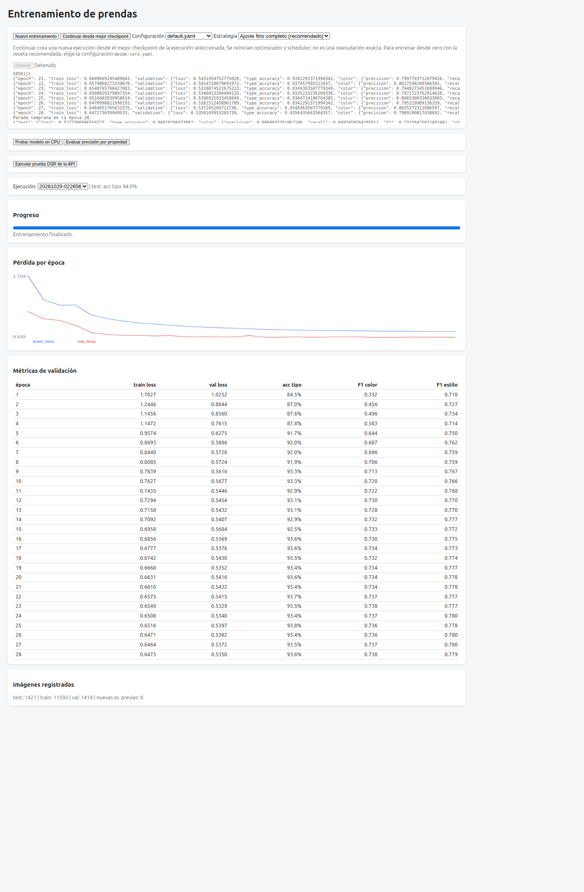
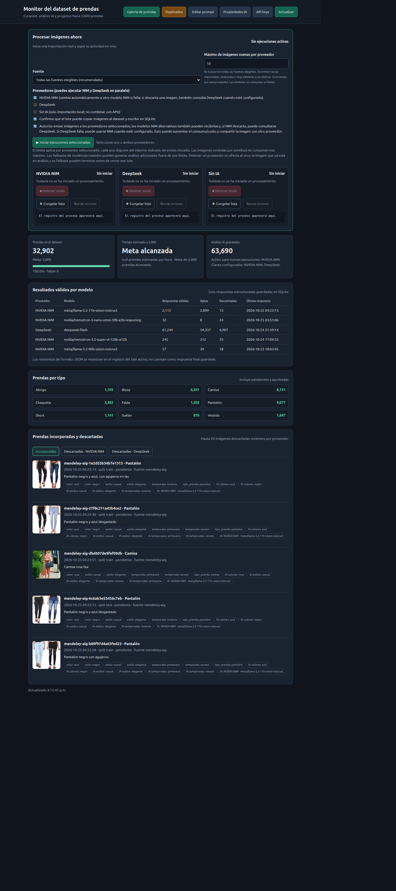

# Guía de interfaces — botones y funciones

Guía rápida de las dos interfaces web del sistema: el **panel de entrenamiento** (http://127.0.0.1:8090/) y el **panel de generación del dataset** (http://127.0.0.1:8787/). Incluye capturas de pantalla y la lista de botones con su función.

## 1. Interfaz de entrenamiento

Dirección: http://127.0.0.1:8090/ · Implementación: [`monitor.py`](../../utilidades-entrenamiento/monitor.py).

### Botones principales

| Botón | Función | Acción |
|---|---|---|
| **Nuevo entrenamiento** | Inicia un entrenamiento nuevo con la receta de configuración seleccionada. | `POST /api/start?config=<receta>` |
| **Continuar desde mejor checkpoint** | Crea una nueva ejecución a partir del mejor checkpoint de la ejecución seleccionada; reinicia optimizador y scheduler (no es reanudación exacta). | `POST /api/continue?run=<id>&strategy=<estrategia>&config=<receta>` |
| **Detener** | Detiene el entrenamiento en curso. | `POST /api/stop` |
| **Probar modelo en CPU** | Abre un diálogo para elegir una ejecución y una imagen, y ejecutar inferencia en CPU. | `POST /api/predict?run=<id>` |
| **Evaluar precisión por propiedad** | Abre el diálogo de evaluación de tipo/color/estilo sobre un split. | `POST /api/eval?run=<id>&split=<split>` |
| **Ejecutar prueba DSR de la API** | Ejecuta la prueba DSR completa (1.424 imágenes) contra la API de pruebas del puerto 8082. | `POST http://127.0.0.1:8082/test/run` |

### Selectores

| Selector | Opciones | Función |
|---|---|---|
| **Configuración** | `default.yaml`, `desde-cero.yaml` | Receta de entrenamiento a usar. |
| **Estrategia** | Ajuste fino completo (recomendado) · Solo entrenar las cabezas | Cómo continuar desde el checkpoint. |
| **Ejecución** | IDs de ejecuciones registradas | Ejecución cuyas métricas y progreso se muestran. |

### Botones de los diálogos

| Botón | Diálogo | Función |
|---|---|---|
| **Evaluar** | Precisión por propiedad | Ejecuta la evaluación de métricas por propiedad. |
| **Exportar PDF** | Precisión por propiedad | Imprime/exporta el resultado de la evaluación. |
| **Predecir** | Probar pesos en CPU | Ejecuta la inferencia sobre la imagen cargada. |
| **Cerrar** | Ambos | Cierra el diálogo. |

## 2. Interfaz de generación del dataset

Dirección: http://127.0.0.1:8787/ · Implementación: [`dashboard.py`](../../utilidades-entrenamiento/modelo-general-destilacion/dashboard.py) y [`dashboard.html`](../../utilidades-entrenamiento/modelo-general-destilacion/dashboard.html).

### Navegación superior

| Botón / enlace | Función | Acción |
|---|---|---|
| **Galería de prendas** | Abre la galería con filtros por categoría y proveedor. | `GET /galeria` |
| **Duplicados** | Abre la gestión de grupos duplicados. | `GET /duplicados` |
| **Editar prompt** | Abre el modal para editar el prompt de anotación enviado a los proveedores. | `POST /api/prompt` |
| **Propiedades IA** | Abre el modal para definir las propiedades a extraer. | `POST /api/properties` |
| **API keys** | Abre el modal para guardar las claves de los proveedores. | `POST /api/credentials` |
| **Actualizar** | Recarga el resumen (prendas, análisis guardados y resultados). | `GET /api/overview` |

### Procesamiento de imágenes

| Botón | Función | Acción |
|---|---|---|
| **▶ Iniciar ejecuciones seleccionadas** | Inicia la importación/anotación con los proveedores marcados (NIM y DeepSeek en paralelo, o sin IA). | `POST /api/ingest` |
| **■ Detener envío** (por proveedor) | Cancela el lote activo de ese proveedor. | `POST /api/stop` |
| **❄ Congelar lista / ▶ Reanudar lista** (por proveedor) | Pausa o reanuda la cola de ese proveedor en la vista. | Local (sin backend) |
| **Borrar errores** (por proveedor) | Limpia los errores registrados de ese proveedor. | `POST /api/jobs/clear-errors` |

### Pestañas de resultados

| Pestaña | Función | Acción |
|---|---|---|
| **Incorporadas** | Muestra las prendas incorporadas recientemente. | `GET /api/overview` |
| **Descartadas · NVIDIA NIM** | Muestra las descartadas por NIM. | `GET /api/rejections/nim` |
| **Descartadas · DeepSeek** | Muestra las descartadas por DeepSeek. | `GET /api/rejections/deepseek` |

### Botones de los modales

| Botón | Función |
|---|---|
| **Guardar prompt** | Guarda el prompt de anotación editado. |
| **Guardar propiedades** | Guarda las propiedades IA editadas. |
| **Guardar configuración** | Guarda las claves de proveedores. |
| **Cancelar / Cerrar** | Cierran el modal sin guardar. |

## 3. Sub-vistas del panel de dataset

### Galería de prendas (`/galeria`)

| Control | Función |
|---|---|
| **← Monitor** | Vuelve al panel principal. |
| **Categoría** | Filtra la galería por categoría de prenda. |
| **Proveedor** | Filtra por proveedor de anotación. |

### Duplicados (`/duplicados`)

| Botón | Función | Acción |
|---|---|---|
| **Resolver toda la página** | Conserva la imagen recomendada de cada grupo de la página y elimina el resto. | `POST /api/duplicates/resolve` |
| **Dejar solo la verde y eliminar el resto** | Resuelve un grupo conservando la imagen marcada en verde. | `POST /api/duplicates/resolve` |
| **No son duplicadas** | Descarta el grupo como falso positivo. | `POST /api/duplicates/dismiss` |
| **Deshacer** | Revierte una resolución o descarte previo. | `POST /api/duplicates/undo` |
